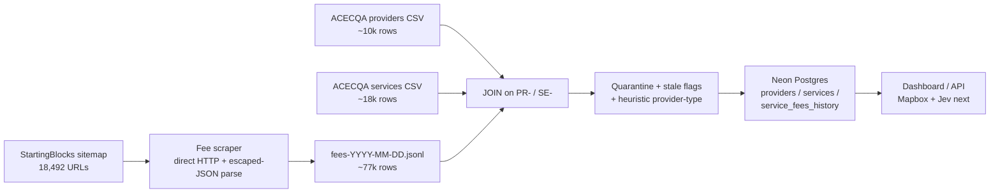
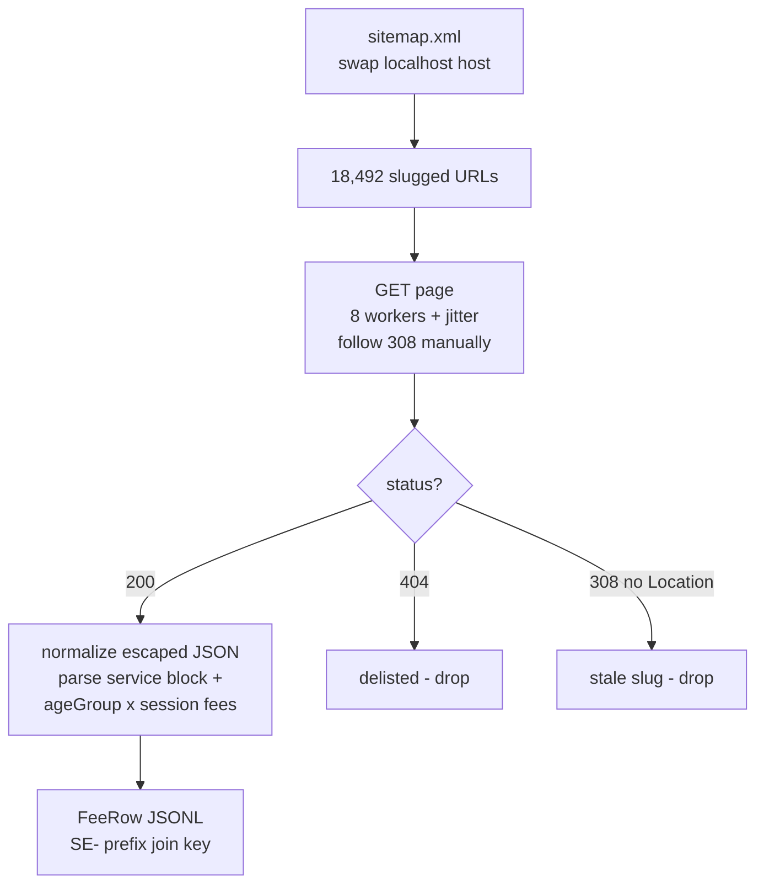
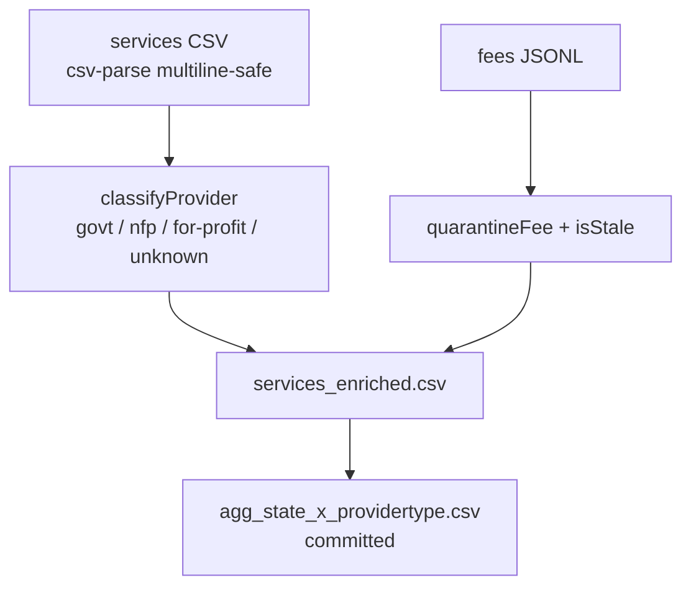
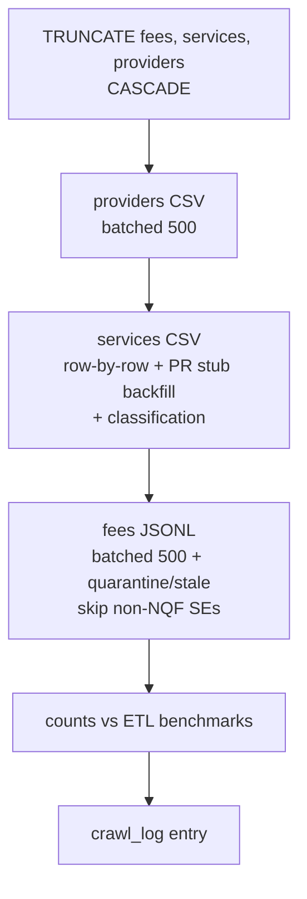
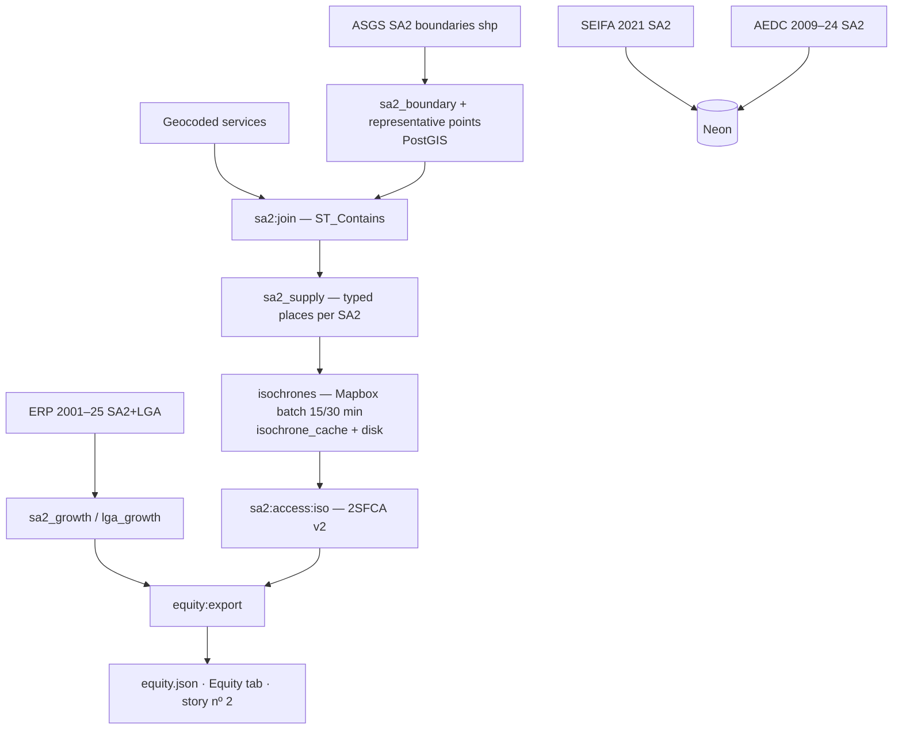

# ETL Pipeline — ChildCareViz

How raw government CSVs + scraped fees become queryable tables in Neon. Run top to bottom; every step is idempotent except the crawl output (date-stamped).

## Overview



## Step 1 — Scrape fee pages



Commands:

```bash
npm run scrape:sitemap          # list URLs only
npm run scrape:fees:sample      # 5-page smoke test
npx tsx src/scraper/run.ts --limit 200 --offset 0   # pilot batch
npm run scrape:fees             # full crawl (~1h)
```

Key facts:

- Pages are ISR server-rendered — plain HTTP GET, no Playwright needed.
- `serviceId` is `SE-000XXXXX` + base64 suffix (NQF) or pure base64 (non-NQF preschools, no ACECQA join).
- 2026-10-16 result: **18,419 ok / 73 failed / 56.8% of pages report fees**. See `docs/crawl-2026-10-16.md`.

## Step 2 — Local ETL + aggregates



```bash
npm run etl:build
```

Rules (`src/etl/rules.ts`, shared with the DB loader):

| Check | Rule |
|---|---|
| `no-fee-reported` | fee is null (service never reported — show "contact service") |
| `fulldy-out-of-range` | FULLDY < $50 or > $300 (weekly-as-daily misfiles, e.g. $796, $16,100) |
| `hourly-suspect-daily-rate` | HOURLY > $30 (median raw was $121 — daily rates misfiled) |
| `oshc/halfdy-out-of-range` | BEFSCH/AFTSCH > $100, HALFDY outside $20–200 |
| `stale` | `fee_last_updated` older than 2 years (range in data: 2018 → 2026) |

Provider heuristic: council/shire/department → `govt` (0.9); Inc/association/church/community/YMCA/Goodstart → `nfp` (0.75); Pty Ltd/Trust → `for-profit` (0.8); bare `Ltd` → `nfp` (0.55). Residual `unknown` (~10%) is the Jev upgrade target.

## Step 3 — Neon load



```bash
npm run db:probe        # connection check (no secrets printed)
npm run db:migrate       # schema + idempotent ALTERs
npx tsx scripts/db-load-full.mts
```

Benchmarks the load must hit: **10,070 providers / 18,183 services / 76,083 fee rows** (from 77,354 crawl rows: 1,199 SE-less occasional-care + 72 non-NQF rows excluded) **/ 99.9% SE-join**. Tables: `providers`, `services`, `service_fees_history`, `crawl_log` (+ PostGIS `spatial_ref_sys`).

Wiring: `src/db/pool.ts` reads `DATABASE_URL` or dashboard-style `PGHOST/PGDATABASE/PGUSER/PGPASSWORD` from `.env` (gitignored). `pg` driver suits the current Node batch architecture and the future API alike.

## Step 4 — Spatial access & equity (2SFCA v2)



The access metric (2SFCA v2): each SA2 gets a representative point (`ST_PointOnSurface`;
re-pointed by `sa2:fallback` to its closest edge to care when the point can't reach any
LDC — fixes island/large-rural artifacts), 15- & 30-minute Mapbox driving catchments
(cache-first — reruns cost $0), LDC approved places shared across reachable demand with
stepped decay (w=1 ≤15 min, w=0.5 15–30 min; symmetric-catchment approximation, v1
distance model kept for QC, r=0.893). Bands are national tertiles among SA2s with ≥100
kids 0–4 (ABS ERP 2025); SA2s with nothing reachable inside 30 min get an explicit zero
and band "no-service".

```bash
npm run abs:trends      # ERP 2001–25 → sa2_growth / lga_growth + summary views
npm run seifa:load      # SEIFA 2021 IRSAD → seifa_sa2
npm run aedc:load       # AEDC 2009–24 → aedc_sa2
npm run sa2:boundary    # ASGS shapefile → sa2_boundary (+ points)
npm run sa2:fallback    # re-point SA2s whose point can't reach any LDC
npm run sa2:join        # ST_Contains service→SA2, typed places → sa2_supply
npm run sa2:geo         # simplified shapes → dashboard/sa2-geo.json
npm run sa2:access      # v1 distance-proxy 2SFCA (QC / fallback)
npm run isochrones      # Mapbox batch → isochrone_cache + data/processed/isochrones
npm run sa2:access:iso  # v2 isochrone 2SFCA → sa2_access_iso · sa2-access.json
npm run equity:export   # merge all → equity_sa2 · dashboard/equity.json
npm run hours:stats     # hours coverage / 6pm cliff → dashboard/hours.json
```

Caveats: LGA rollup deferred (no SA2→LGA allocation table offline); 88 demand SA2s lack
SEIFA; 124 SA2s (1,992 kids) have no LDC reachable inside 30 min from anywhere in the
polygon ("no-service", counted as desert-access in priority lists); competition-adjusted
scores can read low for supply hubs (Fremantle: 67 places/100 locally but bottom-third
score); approved hours ≠ actual hours (61% of close times parseable); 2030 figures are a
scenario extending the 5-year trend with today's places, not a forecast.

## Failure log (kept honest)

1. Fee parser missed everything — page JSON is backslash-escaped (`\"service\"`). Fixed with normalize-first.
2. Full-load #1: providers batch had 5 target cols / 4 placeholders. #2: literal appended outside row parens. #3: gap numbering on skipped rows. All fixed with sequential `$n` builder.
3. `services_provider_approval_no_fkey` on empty providers — loader now upserts provider stubs first.
4. Missing `services.provider_type` columns — added to `schema.sql` + idempotent `ALTER`s in migrate.

## Next upgrades

- Jev `Choice(provider_type)` to resolve the residual `unknown`s with confidence scores.
- LGA rollup for council planners (needs an SA2→LGA allocation table).
- Public-transport catchments alongside driving (GTFS-based, off-peak).
- Story nº 3 — "Out of pocket, really" (CCS subsidy modelling).
